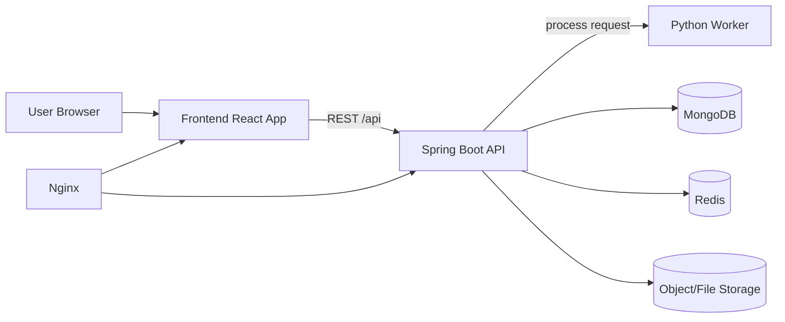

# Architecture Overview

## System Objectives

Musu PDF is a modular PDF utility platform that supports:
- Secure upload and processing of documents.
- Async processing for long-running operations.
- Scalable service separation for frontend, backend, and worker runtimes.
- Future extensibility for OCR, office conversions, and AI features.

## Service Topology

## Monorepo Structure

- `frontend`: React + TypeScript + Vite application.
- `backend`: Spring Boot API and orchestration service.
- `worker`: Python processing engine.
- `nginx`: reverse proxy config.
- `docs`: handover and operating documentation.

## Frontend Architecture

Key concepts:
- Tool registry model defines categories, routes, endpoints, and config schema.
- Reusable workflow components are used across tools.
- UI workflow states:
  1. upload
  2. configure
  3. processing
  4. result
  5. error

Core modules:
- Routing and pages.
- Component library (upload, states, tool cards, layout).
- API service layer with base URL from environment.

## Backend Architecture

Package boundaries:
- `controller`: REST endpoint layer.
- `service`: business orchestration and async job lifecycle.
- `processing`: worker client integration.
- `storage`: secure file IO and path controls.
- `model` + `repository`: persistence layer.
- `security`: auth scaffolding and rate limiting filter.
- `exception`: global exception mapping.
- `dto`: stable API envelope and typed responses.

Job lifecycle:
1. Receive multipart request.
2. Validate and store files in job-scoped directory.
3. Create job record with `QUEUED` status.
4. Execute worker call asynchronously.
5. Transition to `PROCESSING`, then `COMPLETED` or `FAILED`.
6. Expose status and downloadable artifact.
7. Cleanup expired jobs and files via scheduler.

Job store modes:
- `mongo` (default): persistent, production-oriented metadata store.
- `memory`: in-process fallback mode for local/demo runs without MongoDB.

Configuration:
- `JOB_STORE_MODE=mongo|memory`

## Worker Architecture

Worker responsibilities:
- Execute CPU/file-heavy PDF operations.
- Return deterministic output path and success/failure.
- Avoid direct public access.

Operation dispatcher pattern:
- Input: operation slug + input files + output file + config.
- Dispatch to operation function.
- Raise explicit error on unsupported operation.

Currently implemented core operations:
- merge
- split by ranges
- compress
- rotate
- jpg to pdf
- pdf to jpg
- organize by page order

## Security Architecture

Current safeguards:
- Extension allowlist.
- Filename sanitization.
- Path traversal protections via normalized paths.
- Isolated job folder boundaries.
- Scheduled data retention cleanup.
- API rate limiting filter.

Planned hardening:
- Full authN/authZ.
- Virus scanning.
- Signed download URLs.
- Enhanced audit trail and immutable security events.

## Scaling Strategy

Horizontal scaling plan:
- Frontend stateless: scale via replicas/CDN.
- Backend stateless API nodes behind load balancer.
- Worker pool scaled independently by queue depth.
- Shared object storage for cross-node artifact access.
- Redis-backed distributed queue/status store.

## Non-Functional Targets (Recommended)

- API p95 latency for submit endpoints: < 300ms.
- Job status query p95: < 150ms.
- Upload size policy and timeout per tool category.
- Cleanup SLA for expired files: <= 30 minutes.
- Zero plaintext logging of passwords/document content.

## Known Gaps

- Redis is not yet used as a full queue broker.
- Worker dependencies may vary by host OS (especially OCR libs).
- Frontend PDF thumbnail rendering is currently placeholder-level.
